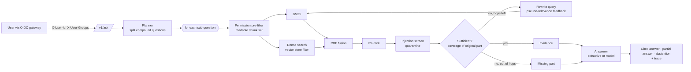

# Architecture

## Request path

## Components and contracts

Every stage is a small protocol, so a production component replaces an offline one
without touching the loop.

| Protocol | Method | Offline | Production |
|---|---|---|---|
| `Embedder` | `fit(texts)`, `embed(texts) -> matrix` | `LsaEmbedder` | `OpenAICompatibleEmbedder` |
| `VectorStore` | `add(chunks, vectors)`, `search(vector, k, groups)` | `InMemoryVectorStore` | `QdrantVectorStore` |
| `Reranker` | `rerank(query, hits)` | `FeatureReranker` | `LLMReranker`, or a cross-encoder |
| `Planner` | `decompose(question)` | `RulePlanner` | `LLMPlanner` |
| `Answerer` | `answer(question, parts, evidence) -> Draft` | `ExtractiveAnswerer` | `LLMAnswerer` |
| `ModelProvider` | `complete(messages, tools)` | `ScriptedProvider` (tests) | `OpenAICompatibleProvider` |

The vector store takes the caller's groups on every search. There is no method that
searches without them, so a new store implementation cannot forget the filter.

## Permissions

- Each document declares `groups`. A document without groups fails to load: the safe
  default for a missing ACL is "not indexed", not "public".
- `Principal.of(user, groups)` always adds `all`.
- The readable chunk set is computed first. BM25 scores only those chunks; the vector
  store filters before scoring (Qdrant: payload filter on `groups`). After fusion, each
  hit is checked again.
- Refusals for "exists but forbidden" and "does not exist" are identical, so a user can't
  probe for restricted documents.
- The eval counts a leak when an answer contains a restricted fact or cites a document
  the asker can't read. CI requires zero.

In a real deployment the groups come from the identity provider (directory groups or
entitlements) and document ACLs from the source system's sharing model at ingest time.
Sync both; a stale ACL is a leak.

## Sufficiency and abstention

For each sub-question the loop measures IDF-weighted term coverage of the best passage
against the **original** sub-question. Measuring against the rewritten query would let
expansion terms, which come from the passage itself, inflate the score. Rare terms carry
more weight, and a term the corpus has never seen gets the highest weight: a question
about something absent should not look covered.

The extractive answerer adds sentence-level checks: the chosen sentence (with its
document title and section) must clear the same kind of coverage bar, and a
when-question needs a sentence that states a time.

Outcomes: answer every part, answer the covered parts and say "I couldn't find: …" for
the rest, or abstain.

## Observability

- JSON logs with a request ID on every line; `X-Request-ID` is accepted (validated) or
  generated, and returned.
- One `arag.query` log record per question: user, groups, number of parts, abstained,
  cited documents, quarantined count, latency. Not the question text, which can contain
  personal data.
- OpenTelemetry spans per stage (`arag.ask`, `arag.retrieve`, `arag.rerank`,
  `arag.generate`) when the `otel` extra is installed.
- Prometheus `/metrics`: request counts and latency histogram per route, and answered,
  abstained and quarantined counters. An abstention rate that jumps after an ingest is a
  useful alert.

## Scaling notes

The offline components are in-process and sized for the demo. For a production corpus:

- Index offline: chunk and embed in a batch job, write to Qdrant (or another store) and
  a lexical engine; the API process only queries.
- Keep BM25 and the vector store filtered by the same ACL field, maintained at ingest.
- Cache embeddings of frequent queries; the answer itself depends on the asker's groups,
  so cache it per (question, groups) or not at all.
- Re-rank only the fused top 20 to 30.

## Known limitations

- Offline sufficiency is lexical. Paraphrases with no shared vocabulary are refused;
  that is the price of failing closed without a model. Hosted embeddings and the model
  answerer remove most of it, and the eval measures the difference.
- A pronoun in a later part ("and when is *its* review due?") loses its subject when the
  question is split. The model planner rewrites parts as self-contained questions.
- The injection screen is pattern-based. It is a first filter in front of the structural
  defence (fenced sources), not a complete detector.
